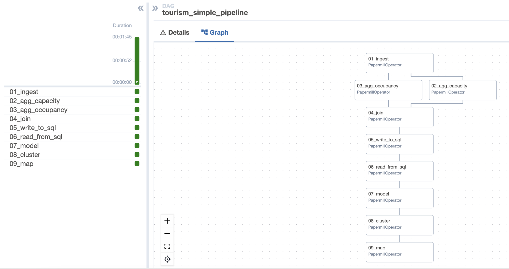
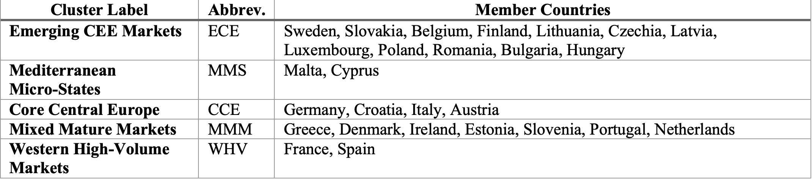
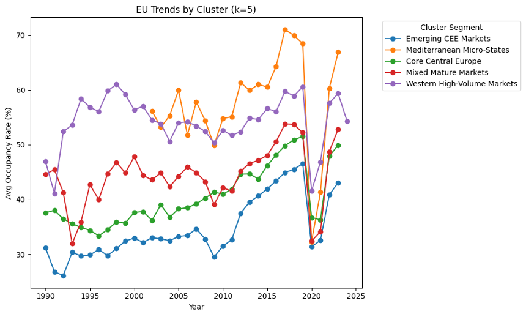
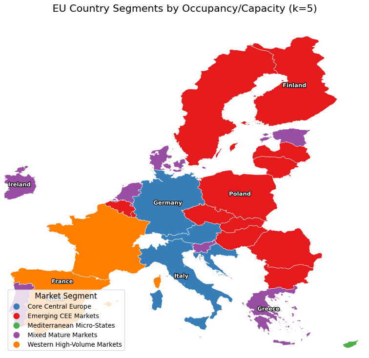

# EU Tourism ETL Pipeline

An end-to-end fully automated data pipeline built with **Apache Airflow**, **Papermill**, and **PySpark** that:

1. **Ingests** raw CSV tourism data (downloaded from [Eurostat – Tourism Statistics](https://ec.europa.eu/eurostat/statistics-explained/index.php?title=Tourism_statistics)) stored in an S3 bucket  
2. **Cleans**, transforms, and writes staging tables into PostgreSQL  
3. **Aggregates**, **models**, **clusters**, and **visualizes** the data (Random Forest forecasting & K-means segmentation)  
4. **Schedules** the entire flow daily via an Airflow DAG  

## 🔄 Pipeline Overview



---

## 📦 What’s Inside

- **`dags/`** – Airflow DAG definition (`tourism_simple_pipeline.py`)  
- **`notebooks/`** – Papermill-parameterized Jupyter notebooks (no outputs)  
- **`docker-compose.yaml`** – Brings up Airflow + PostgreSQL locally  
- **`requirements.txt`** – Python dependencies  
- **`.env.example`** – Template for AWS & Postgres credentials  
- **`.gitignore`** – Excludes secrets, notebook outputs, venvs, DB files  

---

## 🚀 Quickstart

```bash
git clone https://github.com/NarendraSinghChilwal/EU_tourism_ETL.git
cd EU_tourism_ETL

# Copy & configure your credentials
cp .env.example .env
# → open `.env` and fill in:
#    AWS_ACCESS_KEY_ID, AWS_SECRET_ACCESS_KEY,
#    S3_BUCKET, POSTGRES_USER, POSTGRES_PASSWORD,
#    POSTGRES_DB, POSTGRES_HOST, POSTGRES_PORT

# Stand up local services
docker compose up --build
```

This launches:

Postgres on port 5432

Airflow webserver on http://localhost:8080

**Unpause the tourism_simple_pipeline DAG in Airflow and trigger a run.**
---

**🔍 Project Structure**

```text
EU_tourism_ETL/
├── dags/                    # Airflow DAG → tourism_simple_pipeline.py
├── notebooks/               # Papermill notebooks (no outputs)
├── docker-compose.yaml      # Local Airflow + Postgres setup
├── requirements.txt         # pip install -r requirements.txt
├── .env.example             # Copy to .env and fill in secrets
└── .gitignore               # Ignores secrets, outputs, venvs, DB files
```
---

## 📊 Key Visualizations

### Cluster Membership  


### Cluster Trend Over Time  


### Choropleth Map  



## 📊 Key Findings

- **Forecasting Accuracy**  
  - **Model**: Random Forest  
  - **RMSE**: 4.30  
  - **R²**: 0.83  
  > Lagged occupancy (prior-year) explains ~69% of variance, year index ~21%, capacity ~10%.  

- **Market Segmentation** (K-means, k = 5; silhouette = 0.47)  
  1. **Core Central Europe**: steady growth (Germany, Italy, Austria, Croatia)  
  2. **Emerging CEE Markets**: linear recovery (Poland, Romania, Hungary)  
  3. **Mixed Mature Markets**: mid-range stability (Greece, Ireland, Netherlands)  
  4. **Mediterranean Microstates**: high volatility (Malta, Cyprus)  
  5. **Western High-Volume**: rapid rebound post-2020 (France, Spain)  

These insights enable targeted policy and investment strategies per cluster typology.

---

## 📞 Contact

For questions or collaboration, reach out to **narensinghchilwal@gmail.com**.
